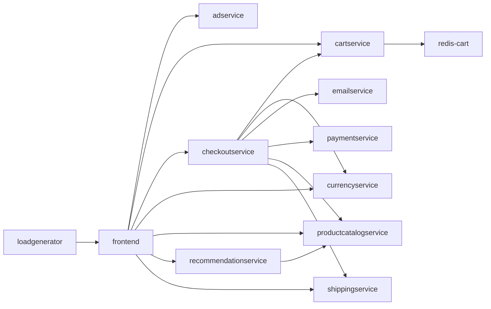

# ChaosPilot AI: AI-driven chaos engineering for cloud-native resilience

A system that **maps** a cloud-native app, **plans** controlled failures, **injects** them with safety
limits, **observes** the impact, then **scores** resilience and **recommends fixes**. Five agents
(Observer, Planner, Injector, Analyst, Reporter) run as a LangGraph state graph, and each round uses
the results of the rounds before it.

Built for the Bosch hackathon problem statement "AI-Driven Chaos Engineering for Cloud-Native Resilience".

| | |
|---|---|
| Sample app | [Google Online Boutique](https://github.com/GoogleCloudPlatform/microservices-demo) (12 microservices, Apache-2.0) |
| Sandbox | Local Kubernetes cluster with [kind](https://kind.sigs.k8s.io/) |
| Fault injection | [Chaos Mesh](https://chaos-mesh.org/) |
| Language | Python 3.10+ |
| Agent orchestration | [LangGraph](https://langchain-ai.github.io/langgraph/) state graph |
| LLM | Google Gemini through LangChain, with a rule-based fallback when no key is set |

## How it works


Each round:

1. **Observer** reads the whole app: HTTP probes, deployments, pods, restarts, warning events and logs.
2. **Planner** ranks candidate experiments from the dependency map, the observation and earlier results, and picks one.
3. **Injector** decides whether to inject now and for how long, injects through Chaos Mesh, and can roll the fault back early.
4. **Analyst** scores the result, diagnoses what happened and recommends fixes.

After the last round, the **Reporter** ranks all weaknesses by severity and explains the overall score.

Between the agents and the cluster sits a safety supervisor in plain code: the allowlist, the protected
services, the duration limits and the automatic abort. The agents decide, and the code enforces the limits.
A full diagram is in `docs/architecture.html`.

## Dependency map

The mapper builds this automatically from the app's Kubernetes manifests: 12 services and 16 dependencies.



`productcatalogservice` and `redis-cart` each have four services relying on them, directly or indirectly,
so the Planner targets them first. To regenerate: `python3 -m chaosai map` writes `graph.json` and
`graph.mmd`. Manual corrections go in `graph_overrides` in `config.yaml`.

## Quick start

### Try it without a cluster (offline simulator)

```bash
pip install -r requirements.txt
cd ~/Documents/bosch/ChaosPilotAI
source .venv/bin/activate
python3 -m unittest discover -s tests
# Build the service dependency map
python -m chaosai map

# Measure the healthy baseline; keep your frontend port-forward running
python -m chaosai baseline

# Create a three-experiment plan
python -m chaosai plan --n 3 --planner rule-based

# Review the plan before injecting faults
cat plan.json

# Run the experiments and generate the report
python -m chaosai run --plan plan.json

# Open/regenerate the latest report
python -m chaosai report
```
Open the newest `runs/*/report.html`. On Windows, use `python` in place of `python3`.
The simulator is a toy model for development; its numbers are not real results.
A pre-generated example report is in `docs/sample-report.html`.

### On a real cluster

Prerequisites: Docker, kind, kubectl, helm, Python 3.10+, and about 8 GB of free memory for Docker.

**Linux or macOS**
```bash
./setup.sh                                          # kind + Online Boutique + Chaos Mesh
kubectl port-forward deployment/frontend 8080:8080  # separate terminal, keep running
```

**Windows, or by hand**
```bash
pip install -r requirements.txt
kind create cluster --name chaos
kubectl apply -f sample/kubernetes-manifests.yaml
kubectl get pods                                    # repeat until all 12 are Running 1/1
helm repo add chaos-mesh https://charts.chaos-mesh.org
helm repo update
helm install chaos-mesh chaos-mesh/chaos-mesh -n chaos-mesh --create-namespace --set chaosDaemon.runtime=containerd --set chaosDaemon.socketPath=/run/containerd/containerd.sock
kubectl port-forward deployment/frontend 8080:8080  # separate terminal, keep running
```

Check that `http://localhost:8080` shows the shop, then run the agent loop:
```bash
python3 -m chaosai map
python3 -m chaosai baseline --seconds 60
python3 -m chaosai agent --rounds 3
```

### Monitor faults you inject yourself (local Ollama)

The `monitor` command is separate from `agent`: it does not inject faults. It continuously checks the
configured HTTP URLs and Kubernetes deployment/pod health, warning events, and recent logs for
unhealthy pods. On an incident it asks the local Ollama model for a diagnosis. It can offer a
human-approved scale-up only for an affected, stateless app deployment; it will not scale Redis or
protected services. No change is made unless you type `yes`. Incident records are appended to
`runs/monitor/incidents.jsonl`.
The monitor keeps Ollama's model loaded for 10 minutes after a diagnosis and limits generated output
to keep incident responses concise; adjust `keep_alive`, `num_ctx`, and `num_predict` under
`local_agent` if needed. The console shows when diagnosis starts and how long it took. A smaller
Ollama model can be selected in config for faster responses on CPU, with a possible quality trade-off.

Install/start Ollama and download the configured model:

```bash
ollama pull qwen2.5:3b
ollama serve                         # only if Ollama is not already running
```

Keep the frontend port-forward running in another terminal, then start the monitor:

```bash
python3 -m chaosai map
python3 -m chaosai baseline --seconds 30
python3 -m chaosai monitor
```

Leave the monitor running while you manually inject a fault through the Chaos Mesh dashboard or
`kubectl`. Stop it with Ctrl+C. The monitor needs Kubernetes read access to deployments, pods,
warning events, and logs; approving a scale-up also requires permission to scale a deployment.

### Turning on the LLM

```bash
pip install -r requirements.txt          # includes langgraph and langchain-google-genai
export GEMINI_API_KEY=your-gemini-api-key
python3 -m chaosai agent --rounds 3 --planner llm
```
The first line of the run then reads `Agents (llm)`, and the report names the Gemini model.
The model defaults to `gemini-3.8-flash`; override it with `CHAOSAI_MODEL`.

| `--planner` value | Behaviour |
|---|---|
| `auto` (default) | Agents use Gemini when a key is set, otherwise the local rules |
| `llm` | Agents use Gemini, and the run stops with an error if it is unavailable at the start |
| `rule-based` | Agents use the local rules only |

If one agent gets an unusable answer from the model, that agent falls back to its rules for that round
and the session continues. Set `CHAOSAI_LLM_BACKEND=google-genai` to call Gemini through Google's SDK
instead of LangChain. Without LangGraph installed, the same agents run in a plain Python loop.

## Commands

| Command | What it does | Slide milestone |
|---|---|---|
| `map` | Parses manifests into `graph.json` + `graph.mmd` | Application mapping |
| `baseline` | Measures normal error rate and p95 latency | Monitoring baseline |
| `agent --rounds 3` | Agent graph: observe, plan, inject and analyze one experiment per round, then rank the findings | Plan, inject, observe, analyze, report |
| `monitor` | Observe manually injected faults and request local Ollama diagnosis | External fault monitoring |
| `plan --n 3` | Chooses a fixed list of experiments and explains why | Plan experiments |
| `run` | Runs a saved plan with safety limits, scores it, writes the HTML report | First failure, safety controls |
| `fix` | Applies safe automatic fixes (scale to 2 replicas) from the last run | Recommend fixes |
| `rerun` | Re-runs the same plan and compares to the previous score | Verify the fix |
| `report` | Regenerates a report | Analyze and report |
| `kill` | Panic button: stops the session and deletes all chaosai experiments | Safety controls |

Add `--sim` before the command to use the simulator, for example `python3 -m chaosai --sim agent`.

## The agents

All five are in `chaosai/agents.py`, wired together in `run_agents`.

| Agent | Decides | Reads |
|---|---|---|
| **Observer** | Whether the app is healthy enough to test, and which services already look unhealthy | HTTP probes, deployments, pods, restarts, warning events, logs |
| **Planner** | A ranked list of five candidate experiments, and which one runs next | Dependency map, the Observer's report, earlier results |
| **Injector** | Whether to inject now, for how long, and whether to roll back early | Pre-flight probes, live readings during the fault, safety limits |
| **Analyst** | What the failure revealed, its severity, and the recommended fixes | Before, during, recovery and after measurements; cluster state during the fault |
| **Reporter** | The ranking of all weaknesses by severity, and what the score means | Every experiment's result, score and diagnosis |

With a Gemini key, each agent asks the model for its decision and the code validates the answer before
using it. Without a key, each agent uses transparent rules. For example, the Planner scores every allowed
pair: +3 per service relying on it, +4 for a single replica, +5 for a failure type not tried yet, -3 per
earlier test on that service, -6 if the service is already confirmed weak.

The model never controls these: the allowed failure types, the protected services, the duration limits,
the automatic abort and the score formula.

## Failures injected

| Failure | Chaos Mesh kind | Effect |
|---|---|---|
| `pod-failure` | PodChaos | One pod of the service is unavailable |
| `network-delay` | NetworkChaos | 500 ms latency (50 ms jitter) on the service |
| `cpu-stress` | StressChaos | 2 CPU workers at 90% load in one pod |

Each experiment targets one service and lasts up to 60 seconds. The Injector may choose a shorter
duration, never below 15 seconds. Settings are in `config.yaml`.

## Safety design

1. **Allowlist.** Only `pod-failure`, `network-delay` and `cpu-stress` exist in `chaos.py`. Anything else raises an error.
2. **LLM proposes, code disposes.** Every LLM suggestion is validated against the allowlist, the dependency graph and the exclusion list before it can run.
3. **Small blast radius.** One service per experiment, `mode: one` for pod and CPU faults, a fixed duration so Chaos Mesh also expires faults on its own, and `frontend`/`loadgenerator` are never targeted.
4. **Pre-flight check.** The Injector agent refuses to start if the app is already unhealthy, and the Planner never targets a service the Observer reported as unhealthy.
5. **Automatic abort** on rolling error rate, p95 latency, or number of newly unhealthy pods (`safety:` in `config.yaml`). The time taken to remove the fault is measured and shown in the report.
6. **Agent rollback.** While a fault is active, the Injector agent reviews the readings and can remove the fault early. The guard in step 5 is always checked first and cannot be overridden.
7. **Manual kill switch:** Ctrl+C, `python3 -m chaosai kill`, or `touch runs/STOP`. The fault is always deleted in a `finally` block.
8. To rehearse the abort for the demo, use the strict test config: `python3 -m chaosai --config config-safety-test.yaml run`.

## Resilience score

Each experiment scores 100 minus penalties; the overall score is the mean.

| Penalty | Max | Full penalty when |
|---|---|---|
| Errors | 40 | mean error rate during the fault is 50% or more |
| Latency | 25 | p95 is 10x the baseline p95 or more |
| Recovery | 25 | recovery takes 60s or more, or never happens |
| Safety abort | 10 | the guard had to stop the experiment |

Weaknesses are the experiments scoring below 90. The score is always calculated by this formula; the
Reporter agent explains it but cannot change it. Edit the constants at the top of `chaosai/analyzer.py` to tune.

## The report

Each run writes `runs/<id>/report.html` and `results.json`. The report shows:

- the overall resilience score, and which agents used the LLM
- weaknesses ranked by severity, with the reason for each
- a score bar for every experiment
- for each experiment: the Observer's note, the Planner's ranked candidates, a latency and error timeline
  across the four phases (before, during, recovery, after), the four-phase measurements, the observed
  impact, the recovery assessment, the diagnosis and the recommended fixes
- the dependency map

## Project layout

```
chaosai/
  mapper.py    manifests -> dependency graph
  planner.py   LLM + rule-based experiment planning, with validation
  agents.py    the five agents and the LangGraph state graph that runs them
  chaos.py     allowlisted Chaos Mesh manifests
  guard.py     abort rules
  runner.py    inject, observe in four phases, recover; hook for agent rollback
  analyzer.py  score formula and rule-based recommendations
  report.py    self-contained HTML report
  env.py       KubeEnv (real cluster, including pod/event/log reading) and SimEnv (offline simulator)
  llm.py       Gemini through LangChain, with Google's SDK as a fallback
  config.py    defaults, merged with config.yaml
  cli.py       commands
tests/         27 unit tests (mapper, rendering, guard, scoring, planner, simulated runs, all five agents)
sample/        Online Boutique manifest used when the upstream repo is not cloned
docs/          architecture page, dependency map, sample report
```

## Troubleshooting

- **Baseline shows errors:** the port-forward is not running, or pods are not ready (`kubectl get pods`).
- **Chaos Mesh pods crash on kind:** check the containerd settings in `setup.sh`.
- **Network delay has no effect:** make sure the `chaos-daemon` pods are running in the `chaos-mesh` namespace.
- **A fault will not go away:** `python3 -m chaosai kill`.
- **The run says `rule-based` although a key is set:** install the requirements and check `GEMINI_API_KEY` is exported in the same terminal. Use `--planner llm` to see the error.
- **The first line says `Python loop`:** LangGraph is not installed. Run `pip install -r requirements.txt`.
- **The Gemini call fails through LangChain:** set `CHAOSAI_LLM_BACKEND=google-genai` and run again.
- **A manifest is rejected:** `kubectl apply --dry-run=server -f runs/<id>/<file>.yaml` shows why.
- **Real-cluster behavior not matching the simulator:** the simulator is a toy model. Trust cluster numbers.

## Tools and libraries used

Online Boutique (sample app), kind, kubectl, Helm, Chaos Mesh, Python, PyYAML, LangGraph, LangChain
(`langchain-google-genai`), the Google Gen AI Python SDK (`google-genai`) and the Gemini API.

## Ideas to extend

Alerts before and at the abort point, a checkout probe, a traffic-spike fault, combined failures, a live
dashboard, Prometheus/OpenTelemetry queries in the guard, more automatic fixes, and scheduled runs in CI.
