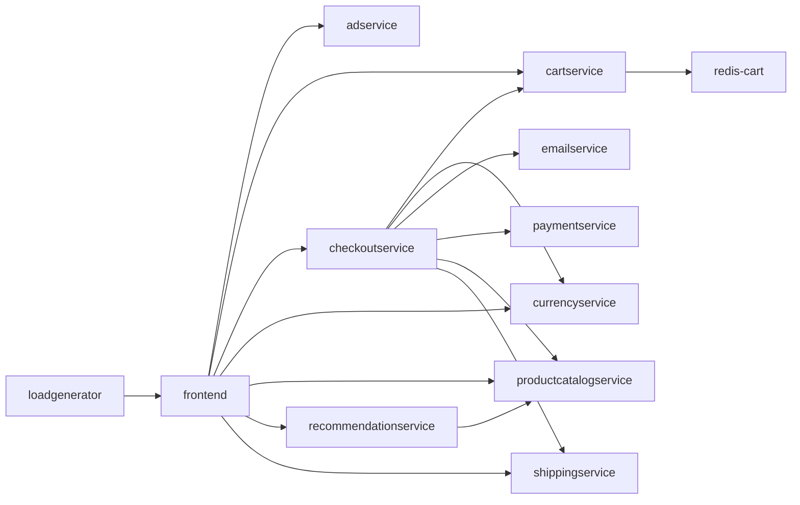

# ChaosPilot AI: AI-driven chaos engineering for cloud-native resilience

A system that **maps** a cloud-native app, **plans** controlled failures, **injects** them with safety
limits, **observes** the impact, then **scores** resilience and **recommends fixes**. Three agents
(Planner, Injector, Analyst) run in a loop, and each round uses the results of the rounds before it.

Built for the Bosch hackathon problem statement "AI-Driven Chaos Engineering for Cloud-Native Resilience".

| | |
|---|---|
| Sample app | [Google Online Boutique](https://github.com/GoogleCloudPlatform/microservices-demo) (12 microservices, Apache-2.0) |
| Sandbox | Local Kubernetes cluster with [kind](https://kind.sigs.k8s.io/) |
| Fault injection | [Chaos Mesh](https://chaos-mesh.org/) |
| Language | Python 3.10+ |
| LLM | Optional (Anthropic API), with a rule-based fallback |

## How it works

```
Manifests --> Mapper --> dependency graph
                              |
        +---------------------v----------------------+
        |  PLANNER agent: picks one service + fault  |<-----------+
        +---------------------+----------------------+            |
                              v                                   |
        +--------------------------------------------+            |
        |  INJECTOR agent: pre-flight check, inject  |   results of this round
        |  through Chaos Mesh, watch                 |   feed the next decision
        |     GUARD (plain code): abort on limits    |            |
        +---------------------+----------------------+            |
                              v                                   |
        +--------------------------------------------+            |
        |  ANALYST agent: score, verdict, fixes      |------------+
        +---------------------+----------------------+
                              v
                 report.html + results.json
```
A full diagram is in `docs/architecture.html`.

## Dependency map

The mapper builds this automatically from the app's Kubernetes manifests: 12 services and 16 dependencies.




`productcatalogservice` and `redis-cart` each have four services relying on them, directly or indirectly,
so the Planner targets them first. To regenerate: `python3 -m chaosai map` writes `graph.json` and
`graph.mmd`. Manual corrections go in `graph_overrides` in `config.yaml`.

## Quick start

### Try it without a cluster (offline simulator)

```bash
pip install -r requirements.txt
python3 -m chaosai --sim map
python3 -m chaosai --sim baseline
python3 -m chaosai --sim agent --rounds 3
python3 -m unittest discover -s tests
```
Open the newest `runs/*/report.html`. On Windows, use `python` in place of `python3`.
The simulator is a toy model for development; its numbers are not real results.
Open the newest `runs/*/report.html`. A pre-generated example is in `docs/sample-report.html`.
Reports identify the Gemini model and label its planner rationale and optional run summary. Probe
measurements, resilience scores, and fix recommendations are calculated by ChaosPilot.

### On a real cluster

Prerequisites: Docker, kind, kubectl, helm, Python 3.10+, and about 8 GB of free memory for Docker.

**Linux or macOS**
```bash
./setup.sh                                          # kind + Online Boutique + Chaos Mesh
kubectl port-forward deployment/frontend 8080:8080  # separate terminal, keep running
```

**Windows, or by hand**
```bash
pip install -r requirements.txt
kind create cluster --name chaos
kubectl apply -f sample/kubernetes-manifests.yaml
kubectl get pods                                    # repeat until all 12 are Running 1/1
helm repo add chaos-mesh https://charts.chaos-mesh.org
helm repo update
helm install chaos-mesh chaos-mesh/chaos-mesh -n chaos-mesh --create-namespace --set chaosDaemon.runtime=containerd --set chaosDaemon.socketPath=/run/containerd/containerd.sock
kubectl port-forward deployment/frontend 8080:8080  # separate terminal, keep running
```

Check that `http://localhost:8080` shows the shop, then run the agent loop:
```bash
python3 -m chaosai map
python3 -m chaosai baseline --seconds 60
python3 -m chaosai agent --rounds 3
```

### Turning on the LLM (optional)

```bash
export ANTHROPIC_API_KEY=sk-ant-...
python3 -m chaosai agent --rounds 3     # the header line now shows "planner (llm)"
**Optional Gemini-powered planner** (otherwise a rule-based planner runs):
```bash
python3 -m pip install google-genai
export GEMINI_API_KEY=your-gemini-api-key
python3 -m chaosai plan --planner llm --n 4
```
The model defaults to `gemini-3.8-flash`; override it with `CHAOSAI_MODEL` if needed.
Choose `--planner rule-based` to force local rules, or `--planner auto` to use Gemini when available
and otherwise fall back to the rules. The same option is available on `agent`.

## Commands

| Command | What it does | Slide milestone |
|---|---|---|
| `map` | Parses manifests into `graph.json` + `graph.mmd` | Application mapping |
| `baseline` | Measures normal error rate and p95 latency | Monitoring baseline |
| `agent --rounds 3` | Agent loop: plan, inject and analyze one experiment per round, learning from each result | Plan, inject, observe, analyze |
| `plan --n 3` | Chooses a fixed list of experiments and explains why | Plan experiments |
| `run` | Runs a saved plan with safety limits, scores it, writes the HTML report | First failure, safety controls |
| `fix` | Applies safe automatic fixes (scale to 2 replicas) from the last run | Recommend fixes |
| `rerun` | Re-runs the same plan and compares to the previous score | Verify the fix |
| `report` | Regenerates a report | Analyze and report |
| `kill` | Panic button: stops the session and deletes all chaosai experiments | Safety controls |

Add `--sim` before the command to use the simulator, for example `python3 -m chaosai --sim agent`.

## The agents

All three are in `chaosai/agents.py`.

| Agent | Decides | How |
|---|---|---|
| **Planner** | Which service to break and with which failure, one decision per round | Scores every allowed pair: +3 per service relying on it, +4 for a single replica, +5 for a failure type not tried yet, -3 per earlier test on that service, -6 if the service is already confirmed weak. With an LLM key, the model proposes and the code validates. |
| **Injector** | Whether it is safe to start, then injects and watches | Refuses if the action is not allowlisted, the service is protected, or the app is already unhealthy. |
| **Analyst** | What the result means and which fixes to recommend | Scores the result, labels it resilient / degraded / weak, lists fixes. Never auto-scales a data store such as Redis. |

The safety guard is deliberately plain code, not an agent: the agents decide, the code enforces the limits.

## Failures injected

| Failure | Chaos Mesh kind | Effect |
|---|---|---|
| `pod-failure` | PodChaos | One pod of the service is unavailable |
| `network-delay` | NetworkChaos | 500 ms latency (50 ms jitter) on the service |
| `cpu-stress` | StressChaos | 2 CPU workers at 90% load in one pod |

Each experiment lasts 60 seconds and targets one service. Settings are in `config.yaml`.

## Safety design

1. **Allowlist.** Only `pod-failure`, `network-delay` and `cpu-stress` exist in `chaos.py`. Anything else raises an error.
2. **LLM proposes, code disposes.** Every LLM suggestion is validated against the allowlist, the dependency graph and the exclusion list before it can run.
3. **Small blast radius.** One service per experiment, `mode: one` for pod and CPU faults, a fixed duration so Chaos Mesh also expires faults on its own, and `frontend`/`loadgenerator` are never targeted.
4. **Pre-flight check.** The Injector agent refuses to start if the app is already unhealthy.
5. **Automatic abort** on rolling error rate, p95 latency, or number of newly unhealthy pods (`safety:` in `config.yaml`). The time taken to remove the fault is measured and shown in the report.
6. **Manual kill switch:** Ctrl+C, `python3 -m chaosai kill`, or `touch runs/STOP`. The fault is always deleted in a `finally` block.
7. To rehearse the abort for the demo, run with a low limit, for example set `max_error_rate: 0.05` in `config.yaml`.

## Resilience score

Each experiment scores 100 minus penalties; the overall score is the mean.

| Penalty | Max | Full penalty when |
|---|---|---|
| Errors | 40 | mean error rate during the fault is 50% or more |
| Latency | 25 | p95 is 10x the baseline p95 or more |
| Recovery | 25 | recovery takes 60s or more, or never happens |
| Safety abort | 10 | the guard had to stop the experiment |

Weaknesses are the experiments scoring below 90, ranked lowest first. Edit the constants at the top of
`chaosai/analyzer.py` to tune.

## Project layout

```
chaosai/
  mapper.py    manifests -> dependency graph
  planner.py   LLM + rule-based experiment planning, with validation
  agents.py    Planner, Injector and Analyst agents and the feedback loop
  chaos.py     allowlisted Chaos Mesh manifests
  guard.py     abort rules
  runner.py    inject, observe, recover
  analyzer.py  scoring + recommendations (+ optional LLM summary)
  report.py    self-contained HTML report
  env.py       KubeEnv (real) and SimEnv (offline simulator)
  llm.py       optional wrapper around the Anthropic API
  config.py    defaults, merged with config.yaml
  cli.py       commands
tests/         12 unit tests (mapper, rendering, guard, scoring, planner, simulated run)
sample/        Online Boutique manifest used when the upstream repo is not cloned
docs/          architecture page, dependency map, sample report
```

## Day-by-day

- **Day 1 checkpoint:** `./setup.sh`, then `map`, `baseline`, one `run` with a low `max_error_rate` to show the kill switch firing. Minimum: running app, dependency map, one safe injection with a working kill switch.
- **Day 2:** set `GEMINI_API_KEY`, `plan`, `run`, `fix`, `rerun`, and show the before/after report.

## Troubleshooting

- **Baseline shows errors:** the port-forward is not running, or pods are not ready (`kubectl get pods`).
- **Chaos Mesh pods crash on kind:** check the containerd settings in `setup.sh`.
- **Network delay has no effect:** make sure the `chaos-daemon` pods are running in the `chaos-mesh` namespace.
- **A fault will not go away:** `python3 -m chaosai kill`.
- **A manifest is rejected:** `kubectl apply --dry-run=server -f runs/<id>/<file>.yaml` shows why.
- **Real-cluster behavior not matching the simulator:** the simulator is a toy model. Trust cluster numbers.

## Tools and libraries used

Online Boutique (sample app), kind, kubectl, Helm, Chaos Mesh, Python, PyYAML, and optionally the Anthropic Python SDK.

## Ideas to extend

Alerts before and at the abort point, a checkout probe, a traffic-spike fault, combined failures, a live
dashboard, Prometheus/OpenTelemetry queries in the guard, LLM-written fixes, and scheduled runs in CI.