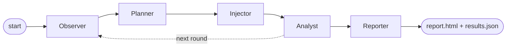
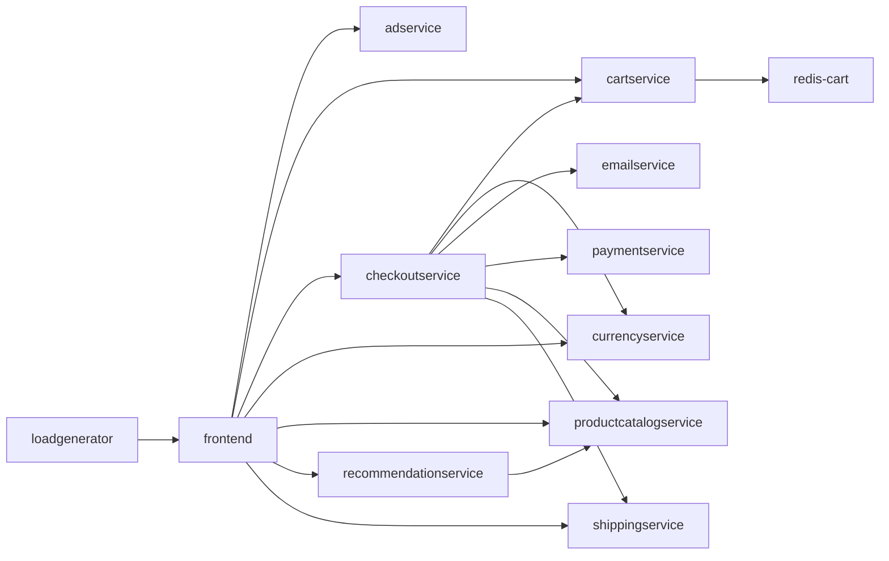

# ChaosPilot AI: AI-driven chaos engineering for cloud-native resilience

ChaosPilot AI finds the weak points of a cloud-native application by breaking it on purpose, safely.
Five AI agents **observe** the application, **decide** what to break, **inject** the failure,
**roll it back**, **explain** what happened, **recommend fixes** and **rank** the weaknesses, while
plain code enforces the safety limits.

Built for the Bosch hackathon problem statement "AI-Driven Chaos Engineering for Cloud-Native Resilience".

| | |
|---|---|
| Sample app | [Google Online Boutique](https://github.com/GoogleCloudPlatform/microservices-demo) (12 microservices, Apache-2.0) |
| Sandbox | Local Kubernetes cluster with [kind](https://kind.sigs.k8s.io/) |
| Fault injection | [Chaos Mesh](https://chaos-mesh.org/), driven by the Injector agent |
| Agent framework | [LangGraph](https://langchain-ai.github.io/langgraph/) state graph |
| LLM | Google Gemini through LangChain (`langchain-google-genai`) |
| Language | Python 3.10+ |

## How it works



Before the agents start, two commands prepare the ground: `map` builds the dependency map from the
Kubernetes manifests, and `baseline` measures the normal error rate and latency.

Then each round runs four agents in order:

1. **Observer** reads the whole application: live requests, every deployment and pod, restarts, warning events and logs.
2. **Planner** ranks five candidate experiments using the dependency map, the Observer's report and earlier results, and picks the top one not yet tested.
3. **Injector** decides whether to inject now and for how long, applies the fault through Chaos Mesh, watches it, and removes it.
4. **Analyst** explains what the failure revealed, sets its severity and recommends fixes.

After the last round the **Reporter** ranks all weaknesses by severity and explains the resilience score.
The full diagram is in `docs/architecture.html`.

## The agents

All five are in `chaosai/agents.py`. They are nodes of one LangGraph state graph built in `run_agents`.

| Agent | Decides | Reads | Acts through |
|---|---|---|---|
| **Observer** | Is the app healthy enough to test, and which services already look unhealthy | HTTP probes, deployments, pods, restarts, warning events, logs | Kubernetes read access |
| **Planner** | A ranked list of candidate experiments and which one runs next | Dependency map, Observer's report, earlier results | The allowlist of faults |
| **Injector** | Inject now or not, for how long, and whether to roll back early | Pre-flight probes, live readings during the fault | Chaos Mesh |
| **Analyst** | Cause, severity and fixes for each experiment | Before, during, recovery and after measurements | The score formula |
| **Reporter** | Order of all weaknesses by severity, and what the score means | Every experiment's result and diagnosis | The HTML report |

### What the AI decides and what the code decides

| Decided by the agents (Gemini) | Always decided by code |
|---|---|
| What to observe and how to describe it | Probe measurements, error rates and latency |
| Which service to break, with which fault, in what order | Which faults exist (the allowlist) and which services are protected |
| Whether and how long to inject, and early rollback | Duration limits and the automatic abort |
| Diagnosis, severity and fixes | The resilience score formula |
| Ranking and summary | Deleting the fault on every exit path |

Every answer from the model is validated against the allowlist, the dependency map and the protected
services before anything runs.

### Rule-based mode

Each agent also has a rule-based version of its decision, so the same pipeline runs without a model:
`--planner rule-based`. For example, the Planner scores every allowed service and fault pair: +3 per
service relying on it, +4 for a single replica, +5 for a fault type not tried yet, -3 per earlier
test on that service, -6 if the service is already confirmed weak. The report always states, per
agent, whether a decision came from Gemini or from the rules.

## Dependency map

The mapper builds this from the app's Kubernetes manifests: 12 services and 16 dependencies.



To regenerate: `python3 -m chaosai map` writes `graph.json` and `graph.mmd`. Manual corrections go in
`graph_overrides` in `config.yaml`.

## Quick start

On Windows, use `python` in place of `python3`.

### 1. Try it without a cluster (offline simulator)

```bash
pip install -r requirements.txt
python3 -m unittest discover -s tests
python3 -m chaosai --sim map
python3 -m chaosai --sim baseline --seconds 15
python3 -m chaosai --sim agent --rounds 3 --planner rule-based
```

Open the newest `runs/<id>/report.html`. The simulator is a toy model for development; its numbers
are not real results.

### 2. Set up the real cluster

Prerequisites: Docker, kind, kubectl, helm, Python 3.10+, and about 8 GB of free memory for Docker.

**Linux or macOS**
```bash
./setup.sh
```

**Windows, or by hand**
```bash
pip install -r requirements.txt
kind create cluster --name chaos
kubectl apply -f sample/kubernetes-manifests.yaml
kubectl get pods                                    # repeat until all 12 are Running 1/1
helm repo add chaos-mesh https://charts.chaos-mesh.org
helm repo update
helm install chaos-mesh chaos-mesh/chaos-mesh -n chaos-mesh --create-namespace --set chaosDaemon.runtime=containerd --set chaosDaemon.socketPath=/run/containerd/containerd.sock
```

Then, in a separate terminal that stays open:

```bash
kubectl port-forward deployment/frontend 8080:8080
```

Check that `http://localhost:8080` shows the shop.

### 3. Run the agents on the cluster

Set the Gemini key as an environment variable. Never put it in a file in this repository.

```bash
export GEMINI_API_KEY=your-key            # PowerShell: $env:GEMINI_API_KEY = "your-key"
python3 -m chaosai map
python3 -m chaosai baseline --seconds 60
python3 -m chaosai agent --rounds 3 --planner llm
```

The first output line names the agents and the orchestrator, for example
`Agents (llm): observer, planner, injector, analyst, reporter. Orchestrator: LangGraph state graph.`

| `--planner` value | Behaviour |
|---|---|
| `auto` (default) | Gemini when a key is set, otherwise the rules |
| `llm` | Gemini; the run stops at the start if no key or client library is found |
| `rule-based` | Rules only, no model calls |

The model name comes from `llm.model` in `config.yaml`; override it with `CHAOSAI_MODEL`.

### 4. Apply a fix and verify it

```bash
python3 -m chaosai fix        # applies the safe automatic fixes from the last run
python3 -m chaosai rerun      # repeats the same experiments and compares the scores
```

## Commands

| Command | What it does |
|---|---|
| `map` | Parses the manifests into `graph.json` and `graph.mmd` |
| `baseline` | Measures the normal error rate and latency |
| `agent --rounds N` | Runs the five agents for N rounds and writes the report |
| `fix` | Applies the safe automatic fixes (scale a stateless service to 2 replicas) from the last run |
| `rerun` | Repeats the last experiments and compares scores with the previous run |
| `report` | Regenerates the HTML report of a run |
| `kill` | Panic button: stops the session and deletes all chaosai faults |
| `plan --n N`, `run` | Without the agent loop: save a fixed list of experiments, then run it |
| `monitor` | Separate watcher: diagnoses faults you inject yourself, using a local Ollama model |

Add `--sim` before the command to use the offline simulator.

## Failures injected

| Failure | Chaos Mesh kind | Effect |
|---|---|---|
| `pod-failure` | PodChaos | One pod of the service is unavailable |
| `network-delay` | NetworkChaos | 500 ms latency (50 ms jitter) on the service |
| `cpu-stress` | StressChaos | 2 CPU workers at 90% load in one pod |

Each experiment targets one service for at most 60 seconds. The Injector may choose a shorter
duration, never below 15 seconds.

## Safety design

1. **Allowlist.** Only the three faults above exist in `chaos.py`. Anything else raises an error.
2. **The model proposes, the code checks.** Every suggestion is validated against the allowlist, the dependency map and the protected services.
3. **Small blast radius.** One service per experiment, one pod for pod and CPU faults, a fixed duration so Chaos Mesh also expires the fault itself, and `frontend` and `loadgenerator` are never targeted.
4. **Pre-flight check.** The Injector refuses to start if the app is unhealthy, and the Planner never targets a service the Observer reported as unhealthy.
5. **Automatic abort** on rolling error rate, p95 latency or newly unhealthy pods (`safety:` in `config.yaml`). The time taken to remove the fault is measured.
6. **Agent rollback.** While a fault is active the Injector reviews the readings and can remove it early. The abort in step 5 is checked first and cannot be overridden.
7. **Manual kill switch.** Ctrl+C, `python3 -m chaosai kill`, or `touch runs/STOP`. The fault is always deleted in a `finally` block.

To rehearse the abort, use the strict limits in `config-safety-test.yaml`:
`python3 -m chaosai --config config-safety-test.yaml agent --rounds 1`.

## Resilience score

Each experiment scores 100 minus penalties; the overall score is the mean.

| Penalty | Max | Full penalty when |
|---|---|---|
| Errors | 40 | mean error rate during the fault is 50% or more |
| Latency | 25 | p95 is 10x the baseline p95 or more |
| Recovery | 25 | recovery takes 60 s or more, or never happens |
| Safety abort | 10 | the guard had to stop the experiment |

Experiments scoring below 90 are listed as weaknesses. The score always comes from this formula in
`chaosai/analyzer.py`; the Reporter explains it but cannot change it.

## The report

Each run writes `runs/<id>/report.html` (self-contained, works offline) and `results.json`. The report shows:

- the overall resilience score and the run's key numbers
- a score bar for every experiment, the points lost by cause, and the findings by severity
- which agents ran, and whether each decision came from Gemini or the rules
- for each round: what the Observer saw and the Planner's ranked candidates
- the Reporter's weaknesses ranked by severity and its explanation of the score
- the recommended fixes, and the before/after comparison once `fix` and `rerun` have been used
- the dependency map as a diagram with the tested services highlighted
- the safety audit: thresholds, aborts and cleanup
- for each experiment: the Injector's decision, the Analyst's diagnosis and evidence, a latency and
  error timeline across the four phases (before, during, recovery, after), and the measurements

## Configuration

Settings are in `config.yaml`; every key is optional.

| Key | Meaning |
|---|---|
| `target_urls` | Pages the prober requests |
| `experiment_duration_s`, `cooldown_s` | Longest fault duration, and the pause between rounds |
| `allowlist`, `exclude_services` | Faults the agents may use, and services they may never target |
| `safety` | Abort thresholds |
| `agent_review_every_samples` | How often the Injector reviews a running fault (in probes) |
| `llm.model` | Gemini model name |
| `graph_overrides` | Manual corrections to the dependency map |

## Project layout

```
chaosai/
  mapper.py       manifests -> dependency map
  agents.py       the five agents and the LangGraph state graph that runs them
  planner.py      candidate ranking (Gemini and rules) and validation
  llm.py          Gemini client with structured JSON output
  runner.py       inject, measure in four phases, recover
  guard.py        abort rules
  chaos.py        allowlisted Chaos Mesh manifests
  analyzer.py     score formula and rule-based recommendations
  report.py       self-contained HTML report
  env.py          KubeEnv (real cluster) and SimEnv (offline simulator)
  local_agent.py  the separate `monitor` command (local Ollama)
  config.py       defaults, merged with config.yaml
  cli.py          commands
tests/            38 unit tests
sample/           Online Boutique manifest used when the upstream repo is not cloned
docs/             architecture diagram, dependency map
```

## Troubleshooting

- **Baseline shows errors:** the port-forward is not running, or pods are not ready (`kubectl get pods`).
- **Chaos Mesh pods crash on kind:** check the containerd settings in `setup.sh`.
- **Network delay has no effect:** check the `chaos-daemon` pods are running in the `chaos-mesh` namespace.
- **A fault will not go away:** `python3 -m chaosai kill`.
- **The first line says `rule-based` although a key is set:** check `GEMINI_API_KEY` is set in the same terminal and the requirements are installed.
- **The first line says `Python loop`:** LangGraph is not installed. Run `pip install -r requirements.txt`.
- **A manifest is rejected:** `kubectl apply --dry-run=server -f runs/<id>/<file>.yaml` shows why.

## Tools and libraries used

Online Boutique (sample app), kind, kubectl, Helm, Chaos Mesh, Python, PyYAML, LangGraph, LangChain
(`langchain-google-genai`), the Google Gen AI Python SDK (`google-genai`) and the Gemini API.